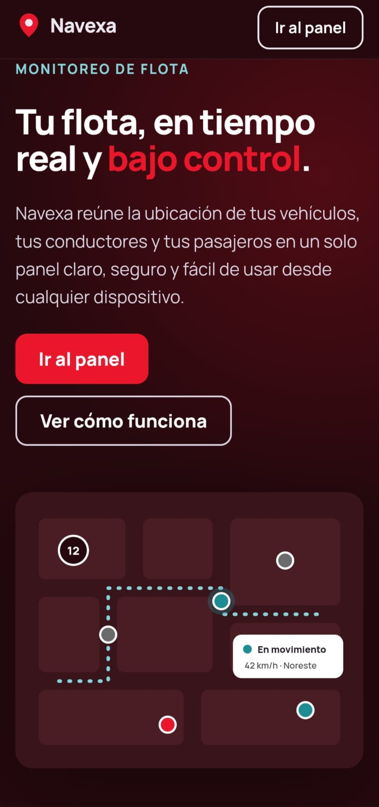
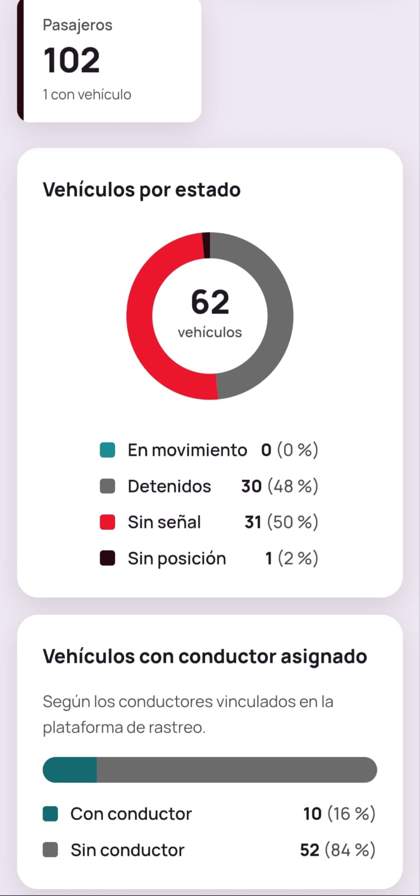
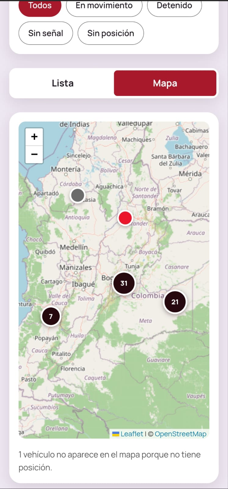
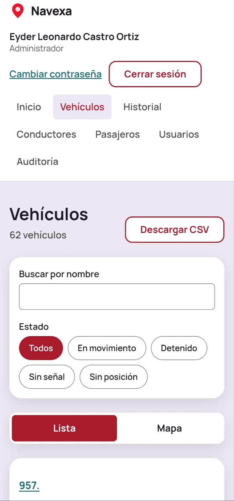
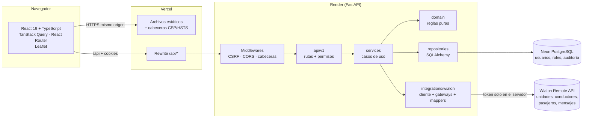
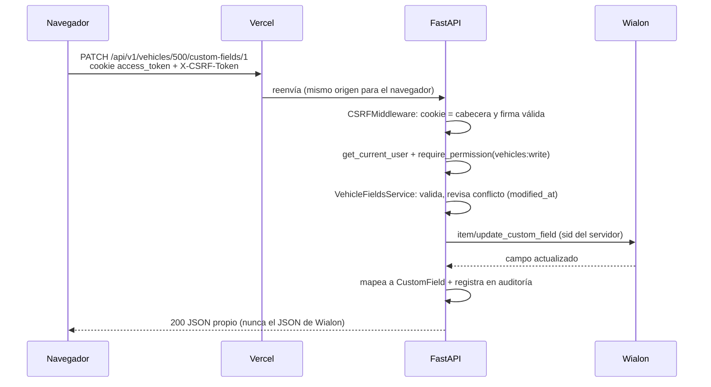
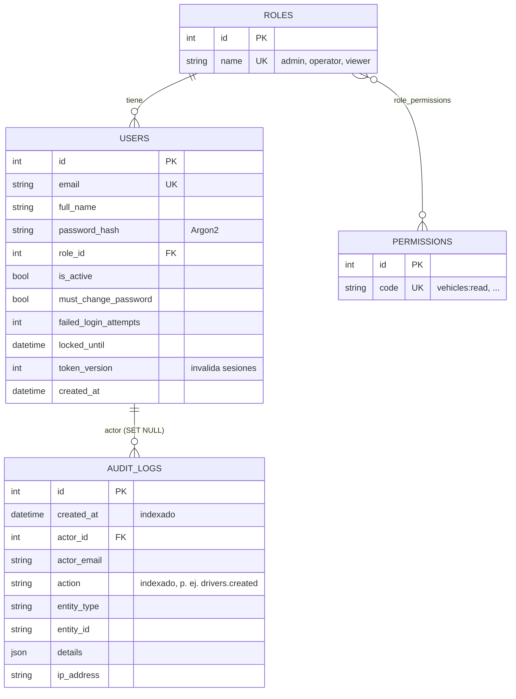
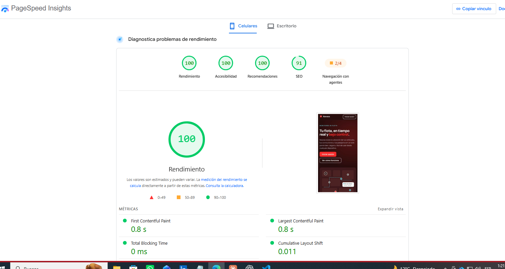

# Navexa

Plataforma web de **monitoreo de flotas** conectada a la API de rastreo **Wialon**: mapa en vivo, dashboard, gestión de conductores y pasajeros, historial de recorridos con reproducción, exportación a CSV y auditoría, con control de acceso por roles.

Prueba técnica para **Ingeniero Fullstack Junior (enfoque front-end)** de GPS Control.

| | |
|---|---|
| **Aplicación (frontend)** | https://navexa-three.vercel.app |
| **API (backend)** | https://navexa-api.onrender.com |
| **Documentación de la API (Swagger)** | https://navexa-api.onrender.com/docs |
| **Repositorio** | https://github.com/hankcas/Navexa |

> El backend usa el plan gratuito de Render, que se duerme tras 15 minutos sin uso. La primera visita puede tardar unos 50 segundos: la aplicación lo avisa con un mensaje de "iniciando servidor" y reintenta sola (DEP-04).

## Contenido

1. [Descripción y capturas](#1-descripción-y-capturas)
2. [Enlaces](#2-enlaces)
3. [Ejecutar en local](#3-ejecutar-en-local)
4. [Arquitectura y modelo de datos](#4-arquitectura-y-modelo-de-datos)
5. [Decisiones de arquitectura](#5-decisiones-de-arquitectura)
6. [Seguridad](#6-seguridad)
7. [Decisiones de diseño](#7-decisiones-de-diseño)
8. [Transformación de datos](#8-transformación-de-datos)
9. [Supuestos y decisiones ante ambigüedades](#9-supuestos-y-decisiones-ante-ambigüedades)
10. [Declaración de uso de IA](#10-declaración-de-uso-de-ia)
11. [Limitaciones conocidas y mejoras futuras](#11-limitaciones-conocidas-y-mejoras-futuras)

---

## 1. Descripción y capturas

### Qué hace

| Módulo | Qué puede hacer el usuario | Requisitos |
|---|---|---|
| **Landing** | Página pública de presentación del producto. | UX |
| **Inicio de sesión** | Entrar con correo y contraseña; cambio obligatorio de la contraseña temporal. | RF-01 a RF-04 |
| **Dashboard** | KPIs de la flota y dos gráficas: vehículos por estado y con/sin conductor. | RF-23 |
| **Vehículos** | Lista con búsqueda, filtro por estado y paginación, sincronizada con un mapa con marcadores agrupados y rumbo. Se actualiza cada 30 s. | RF-10, RF-11, RF-14, RF-15 |
| **Detalle de vehículo** | Datos transformados, posición, conductor, pasajeros y **campos personalizados editables** (actualización optimista con *rollback*). | RF-12, RF-13, RF-19 a RF-22 |
| **Historial de recorrido** | Elegir vehículo y rango de fechas; línea coloreada por velocidad, resumen y **reproducción** con línea de tiempo. | RF-24 |
| **Conductores y pasajeros** | Crear, editar, eliminar, asignar o quitar vehículo, campos personalizados; todo se guarda en Wialon. | RF-08, RF-09, RF-16 a RF-18, RF-27, RF-28 |
| **Exportar CSV** | Descargar vehículos, conductores o pasajeros con los filtros aplicados, protegido contra *CSV injection*. | RF-25 |
| **Usuarios** | Crear usuarios, cambiar rol, activar o desactivar, restablecer contraseña. | RF-05, RF-06 |
| **Auditoría** | Quién hizo qué y cuándo, con filtros y paginación (solo administrador). | RF-26 |

### Roles

| Permiso | Administrador | Operador | Visualizador |
|---|:-:|:-:|:-:|
| Ver vehículos, conductores, pasajeros e historial | ✔ | ✔ | ✔ |
| Editar vehículos (campos), conductores y pasajeros | ✔ | ✔ | — |
| Exportar CSV (`data:export`) | ✔ | ✔ | — |
| Gestionar usuarios (`users:manage`) | ✔ | — | — |
| Ver auditoría (`audit:read`) | ✔ | — | — |

La interfaz pregunta "¿tiene este permiso?" y nunca "¿es administrador?" ([`permissions.ts:23`](frontend/src/features/auth/permissions.ts#L23)). El backend vuelve a comprobar el permiso en cada endpoint ([`dependencies.py:51`](backend/app/api/dependencies.py#L55)).

### Capturas

| Landing | Dashboard |
|---|---|
|  |  |

| Vehículos y mapa | Vista móvil |
|---|---|
|  |  |

Capturas tomadas desde un celular en producción. En pantallas angostas, la lista y el mapa de vehículos se alternan con el selector "Lista / Mapa", y el menú del panel baja a una segunda fila.

---

## 2. Enlaces

- **Frontend en producción:** https://navexa-three.vercel.app
- **API en producción:** https://navexa-api.onrender.com, con chequeo de salud en `/health`.
- **Swagger:** https://navexa-api.onrender.com/docs. Todos los endpoints están protegidos, así que verla no da acceso a datos.

El navegador nunca habla con Render directamente. Vercel reenvía `/api/*` al backend ([`vercel.json`](frontend/vercel.json)), de modo que el frontend y la API comparten el mismo origen. Por qué, en el [ADR-01](#adr-01-proxy-de-vercel-en-lugar-de-cors-con-cookies-entre-sitios).

---

## 3. Ejecutar en local

### Requisitos

- **Python 3.14** y **Node.js 24**. Probado con 3.14.10 y 24.14.1.
- Una base **PostgreSQL**; Neon gratis sirve.
- Un **token de Wialon** con acceso a la cuenta de prueba.

### Backend

```bash
cd backend
python -m venv .venv
source .venv/Scripts/activate        # Windows (Git Bash). En Linux/macOS: source .venv/bin/activate
pip install -r requirements-dev.txt
cp .env.example .env                 # y completa los valores
alembic upgrade head                 # crea las tablas
python -m scripts.seed               # permisos, roles y el primer administrador
uvicorn app.main:app --reload        # http://localhost:8000 · Swagger en /docs
```

Variables de [`backend/.env.example`](backend/.env.example):

| Variable | Para qué |
|---|---|
| `WIALON_BASE_URL`, `WIALON_TOKEN` | Conexión a Wialon. El token solo vive en el backend. |
| `WIALON_RESOURCE_ID` | Opcional: recurso donde se crean conductores y pasajeros. |
| `DATABASE_URL` | `postgresql+asyncpg://…?ssl=require` |
| `FIRST_ADMIN_EMAIL`, `FIRST_ADMIN_PASSWORD`, `FIRST_ADMIN_NAME` | Administrador que crea el seed. La contraseña debe tener mínimo 12 caracteres. |
| `JWT_SECRET` | Firma de los tokens y del token CSRF. |
| `ACCESS_TOKEN_MINUTES`, `REFRESH_TOKEN_DAYS` | Duración de la sesión (15 min / 7 días por defecto). |
| `COOKIE_SECURE`, `COOKIE_SAMESITE` | En local sin HTTPS: `COOKIE_SECURE=false`. |
| `STATUS_MOVING_SPEED_KMH`, `STATUS_OFFLINE_MINUTES` | Umbrales del estado del vehículo (5 km/h y 60 min). |
| `LOGIN_RATE_LIMIT_ATTEMPTS`, `LOGIN_RATE_LIMIT_WINDOW_SECONDS` | Límite de intentos de login por IP. |
| `CORS_ORIGINS` | Vacío: el frontend entra por el proxy de Vercel (mismo origen). |
| `DOCS_ENABLED` | Mostrar u ocultar Swagger. |

Scripts de diagnóstico: `python -m scripts.check_db` y `python -m scripts.check_wialon`.

### Frontend

```bash
cd frontend
npm install
cp .env.example .env                 # opcional: API_PROXY_TARGET si el backend no está en :8000
npm run dev                          # http://localhost:5173
```

Vite reenvía `/api` al backend local ([`vite.config.ts`](frontend/vite.config.ts)), igual que Vercel en producción.

### Pruebas y calidad

```bash
cd backend && python -m pytest                    # 317 pruebas
cd frontend && npm test && npm run lint && npm run build   # 173 pruebas, oxlint y build
```

Las pruebas del backend no llaman a Wialon ni a la base de datos. Usan dobles (*fakes*) inyectados por dependencia ([`tests/fakes.py`](backend/tests/fakes.py)).

---

## 4. Arquitectura y modelo de datos

### Arquitectura



**Capas del backend** (cada una solo conoce a la de abajo):

| Capa | Carpeta | Responsabilidad |
|---|---|---|
| API | [`app/api`](backend/app/api) | HTTP: validar entrada (Pydantic), exigir permisos, devolver modelos propios. |
| Servicios | [`app/services`](backend/app/services) | Casos de uso: reglas de negocio, auditoría, orquestar fuentes. |
| Dominio | [`app/domain`](backend/app/domain) | Reglas puras sin dependencias: estado del vehículo, permisos, geometría. |
| Repositorios | [`app/repositories`](backend/app/repositories) | Acceso a PostgreSQL. |
| Integraciones | [`app/integrations/wialon`](backend/app/integrations/wialon) | Todo lo de Wialon: sesión, servicios (`svc`), nombres cortos de campos, códigos de error. |

**Frontend** organizado por funcionalidad ([`src/features`](frontend/src/features)): cada carpeta trae su página, consultas, tipos y pruebas. Lo compartido (cliente HTTP, componentes de interfaz y formularios) está en [`src/shared`](frontend/src/shared).

### Flujo de una petición



### Modelo de datos

Solo los **usuarios, roles, permisos y la auditoría** viven en PostgreSQL ([`models.py`](backend/app/db/models.py)). Vehículos, conductores, pasajeros y mensajes se leen y escriben siempre en Wialon, que es la fuente de verdad (ver el [ADR-04](#adr-04-wialon-como-única-fuente-de-verdad-de-la-flota)).



Modelos de Wialon que el backend traduce a modelos propios:

| Wialon | Navexa | Dónde |
|---|---|---|
| Unidad (`avl_unit`) | `Vehicle`, `VehicleDetail`, `CustomField` | [`schemas/vehicle.py`](backend/app/schemas/vehicle.py) |
| Conductor de un recurso (`drvrs`) | `Driver` | [`schemas/driver.py`](backend/app/schemas/driver.py) |
| Tag de un recurso (`tags`) | `Passenger` | [`schemas/passenger.py`](backend/app/schemas/passenger.py) |
| Mensajes con posición | `TrackPoint`, `VehicleTrack` | [`schemas/track.py`](backend/app/schemas/track.py) |

---

## 5. Decisiones de arquitectura

### Principios SOLID en el código

| Principio | Dónde se ve |
|---|---|
| **S** · Responsabilidad única | Escribir y leer la auditoría son clases distintas: [`AuditService`](backend/app/services/audit_service.py#L8) registra (todos los módulos lo usan) y [`AuditQueryService`](backend/app/services/audit_query_service.py#L16) consulta con filtros. El formato CSV son funciones puras ([`csv_export.py`](backend/app/services/csv_export.py)), separadas de quién lo descarga ([`ExportService`](backend/app/services/export_service.py#L36)). |
| **O** · Abierto/cerrado | Un módulo nuevo del menú es una línea en [`NAV_ITEMS`](frontend/src/features/panel/navigation.ts#L14) con su permiso; un rol nuevo, una entrada en [`DEFAULT_ROLE_PERMISSIONS`](backend/app/domain/permissions.py), sin tocar las pantallas. |
| **L** · Sustitución de Liskov | Los servicios aceptan cualquier objeto que cumpla el protocolo: el gateway real de Wialon o un *fake* en las pruebas, sin cambiar su comportamiento ([`tests/fakes.py`](backend/tests/fakes.py)). |
| **I** · Segregación de interfaces | Protocolos pequeños según lo que cada servicio necesita: [`VehicleProvider`](backend/app/services/vehicle_service.py#L20) solo lista; [`VehicleCatalog`](backend/app/services/vehicle_service.py#L52) además busca uno; [`TrackSource`](backend/app/services/track_service.py#L16) solo carga recorridos. |
| **D** · Inversión de dependencias | Los servicios dependen de protocolos (`DriverProvider`, `CustomFieldStore`…), no de Wialon. Las implementaciones concretas se arman en un solo lugar, [`dependencies.py`](backend/app/api/dependencies.py), y las pruebas las sustituyen con `dependency_overrides`. |

### Patrones

| Patrón | Uso |
|---|---|
| **Gateway / Adapter** | [`WialonUnitGateway`](backend/app/integrations/wialon/units_gateway.py#L40), [`WialonDriverGateway`](backend/app/integrations/wialon/drivers_gateway.py#L21), [`WialonPassengerGateway`](backend/app/integrations/wialon/passengers_gateway.py#L21): el resto del sistema nunca ve `svc`, `flags`, `n`, `bu`… (INT-03). |
| **Mapper / DTO** | [`mappers.py`](backend/app/integrations/wialon/mappers.py), [`driver_mappers.py`](backend/app/integrations/wialon/driver_mappers.py): JSON de Wialon → modelos Pydantic propios (INT-04). |
| **Repository** | [`UserRepository`](backend/app/repositories/user_repository.py#L7), [`AuditRepository`](backend/app/repositories/audit_repository.py#L10). |
| **Inyección de dependencias** | `Depends` de FastAPI en [`dependencies.py`](backend/app/api/dependencies.py). |
| **Value Object** | [`ResourceItemRef`](backend/app/domain/resource_item_ref.py#L8): el ID público `"recurso-item"` de conductores y pasajeros, validado antes de llegar a Wialon. |
| **Middleware** | [`CSRFMiddleware`](backend/app/core/csrf.py#L70), [`SecurityHeadersMiddleware`](backend/app/core/security_headers.py#L10). |
| **Problem Details (RFC 7807)** | Un solo formato de error para toda la API: [`errors.py`](backend/app/core/errors.py#L22). |
| **Componente genérico** | Conductores y pasajeros comparten una página tipada: [`PeoplePage<T>`](frontend/src/features/people/PeoplePage.tsx#L57). |
| **Actualización optimista** | Snapshot y *rollback* en [`detail/queries.ts`](frontend/src/features/vehicles/detail/queries.ts#L26). |

### ADRs breves

#### ADR-01: proxy de Vercel en lugar de CORS con cookies entre sitios
- **Contexto:** el frontend (`vercel.app`) y la API (`onrender.com`) están en dominios distintos. Las cookies de sesión entre sitios necesitan `SameSite=None`, y los navegadores las bloquean cada vez más.
- **Decisión:** Vercel reenvía `/api/*` a Render. Para el navegador todo es el mismo origen.
- **Consecuencias:** las cookies van `HttpOnly; Secure; SameSite=Lax`, CORS queda **cerrado** (`CORS_ORIGINS=[]`, DEP-03) y la CSP puede decir `connect-src 'self'`. El costo es un salto de red extra.

#### ADR-02: sesión en cookies HttpOnly, no en `localStorage`
- **Decisión:** *access token* de 15 min en una cookie `HttpOnly` y *refresh* de 7 días en otra limitada a `/api/v1/auth`. El JavaScript nunca ve los tokens.
- **Consecuencias:** un XSS no puede robar la sesión. A cambio, las cookies exigen **protección CSRF**: se usa *double-submit* firmado con HMAC ([`csrf.py`](backend/app/core/csrf.py)). Cerrar sesión o cambiar la contraseña sube `token_version`, y eso invalida los tokens anteriores.

#### ADR-03: arquitectura por capas con el dominio en el centro
- **Decisión:** api → services → domain, con repositories e integrations detrás de protocolos.
- **Consecuencias:** las reglas (estado del vehículo, simplificación, permisos) se prueban sin red ni base de datos. Hay más archivos que en un único `main.py`.

#### ADR-04: Wialon como única fuente de verdad de la flota
- **Decisión:** no se copian vehículos, conductores ni pasajeros a PostgreSQL. Se leen y escriben siempre en Wialon.
- **Consecuencias:** no hay datos desincronizados y lo que se edita en Navexa se ve en Wialon. A cambio, cada pantalla depende de la latencia de Wialon, que se mitiga con consultas en paralelo (`asyncio.gather`) y la caché de TanStack Query en el navegador.

#### ADR-05: simplificar el recorrido en el servidor
- **Decisión:** el backend reduce el recorrido con **Douglas-Peucker** (tolerancia de 10 m, máximo 2.000 puntos) antes de enviarlo. Ver [`track_geometry.py:22`](backend/app/domain/track_geometry.py#L22) y [`track_service.py:76`](backend/app/services/track_service.py#L76).
- **Consecuencias:** una semana de un vehículo activo pasa de **32.539 a 1.799 puntos** (de ~5 MB de Wialon a ~200 kB) sin cambiar la forma. Los puntos donde el vehículo arranca o se detiene se conservan siempre, para que la reproducción se pause en las paradas. El cálculo corre en un hilo aparte (`asyncio.to_thread`) para no bloquear a otros usuarios.

---

## 6. Seguridad

### Controles por categoría OWASP Top 10 (2021)

| Categoría | Controles en Navexa |
|---|---|
| **A01 · Control de acceso roto** | RBAC con permisos por endpoint ([`require_permission`](backend/app/api/dependencies.py#L55)). La interfaz solo oculta; el backend decide. Pruebas de autorización por rol en cada módulo ([`tests/api`](backend/tests/api)). IDs validados por patrón antes de llegar a Wialon. La auditoría es de solo lectura: no hay endpoint para editarla ni borrarla. |
| **A02 · Fallas criptográficas** | Contraseñas con **Argon2** ([`security.py:18`](backend/app/core/security.py#L18)). HTTPS en Vercel y Render, con **HSTS**. Cookies `Secure`. Secretos solo en variables de entorno. |
| **A03 · Inyección** | SQLAlchemy con parámetros enlazados (sin SQL armado a mano). Validación con Pydantic de toda entrada. React escapa el texto (no se usa `dangerouslySetInnerHTML`). **CSV injection** neutralizada ([`safe_text`](backend/app/services/csv_export.py#L36)). |
| **A04 · Diseño inseguro** | Bloqueo de cuenta tras 5 intentos fallidos durante 15 min ([`auth_service.py:11`](backend/app/services/auth_service.py#L11)). Límite de intentos por IP ([`rate_limit.py`](backend/app/core/rate_limit.py)). Contraseña temporal con cambio obligatorio. Límites en el historial (7 días, 50.000 mensajes) y en el CSV (10.000 filas). |
| **A05 · Configuración insegura** | CSP estricta en el frontend ([`vercel.json`](frontend/vercel.json)) y en la API. Cabeceras `nosniff`, `Referrer-Policy`, `Permissions-Policy`, `frame-ancestors 'none'`. CORS cerrado. Errores sin trazas internas (Problem Details). Swagger configurable (`DOCS_ENABLED`). |
| **A06 · Componentes vulnerables** | Versiones fijadas en `requirements.txt` y `package-lock.json`. `pip-audit` en las dependencias de desarrollo y `npm audit`. |
| **A07 · Fallas de identificación y autenticación** | Cookies `HttpOnly`. *Access* corto (15 min), renovado con el *refresh* (que también se reemite). Revocación por `token_version`. Política de contraseñas de mínimo 12 caracteres con mayúsculas, minúsculas, números y símbolos ([`password_policy.py`](backend/app/domain/password_policy.py)). Mensaje de error que no revela si el correo existe. |
| **A08 · Integridad de software y datos** | **CSRF** *double-submit* firmado con HMAC-SHA256 en todo POST/PUT/PATCH/DELETE ([`CSRFMiddleware`](backend/app/core/csrf.py#L70)). Conflicto de edición detectado con `expected_modified_at` (409) en lugar de pisar el cambio de otro. Lockfiles versionados. |
| **A09 · Registro y monitoreo** | Auditoría de inicios de sesión (exitosos y fallidos con motivo), cambios de usuarios, conductores, pasajeros, campos personalizados y **descargas de CSV**, con IP. Pantalla de consulta para el administrador (RF-26). |
| **A10 · SSRF** | El backend solo llama a la URL de Wialon fijada en la configuración. Ningún dato del usuario decide a qué servidor se conecta. |

### Modelado de amenazas (breve)

**Activos:** el token de Wialon (da acceso a toda la cuenta), las credenciales de los usuarios, los datos de la flota (posiciones, teléfonos y documentos de conductores y pasajeros) y el registro de auditoría.

| Amenaza (STRIDE) | Ejemplo | Mitigación |
|---|---|---|
| **S**uplantación | Fuerza bruta contra el login | Bloqueo por cuenta + límite por IP + Argon2 |
| **T**ampering (alteración) | Un sitio malicioso envía un formulario usando la sesión del usuario (CSRF) | Token CSRF firmado + `SameSite=Lax` |
| **R**epudio | "Yo no borré ese conductor" | Auditoría con actor, IP y detalle; sin endpoint para borrarla |
| **I**nformation disclosure (fuga) | Robar el token de Wialon o la sesión | Token solo en el backend (INT-02); cookies `HttpOnly`; CSP contra XSS |
| **I**nformation disclosure (fuga) | Exfiltrar la flota | Exportar exige `data:export` y queda auditado |
| **D**enegación de servicio | Pedir un año de historial | Rango máximo de 7 días, 50.000 mensajes, simplificación en un hilo aparte |
| **E**levación de privilegios | Un Visualizador llama directo a la API de escritura | Permiso comprobado en el backend en cada endpoint, con pruebas por rol |

---

## 7. Decisiones de diseño

### Paleta

La paleta obligatoria está en [`tokens.css`](frontend/src/styles/tokens.css): rojo `#EB162C`, rojo oscuro `#A81A2B`, gris `#6B6B6B`, verde azulado `#1E8C93` y lila `#EEE8F2`.

- **Tonos derivados para accesibilidad:** el blanco sobre el rojo de marca `#EB162C` no llega a 4,5:1, así que solo alcanza AA para texto grande. Por eso los botones usan el rojo `#A81A2B` (AA para texto normal) y el rojo de marca queda para acentos. Para texto pequeño se añadieron `#4F4F4F` (gris), `#146A70` (verde azulado) y `#26090E` (fondo oscuro).
- **Contraste comprobado con pruebas:** cada combinación de texto y fondo que usa la interfaz tiene una prueba que exige ≥ 4,5:1 ([`contrast.test.ts`](frontend/src/styles/contrast.test.ts)).
- **Roles en vez de colores sueltos:** los componentes usan `--color-primary`, `--color-text-muted`, `--status-moving`… y nunca el hexadecimal directo. Los mismos colores de estado se usan en el mapa, las tablas, las gráficas y la landing.

### Jerarquía y tipografía

- Fuente **Manrope** autoalojada (la CSP no permite fuentes externas), con pesos 600 a 800 para títulos y datos clave.
- En cada pantalla: un `h1` con el total y el estado de actualización, luego filtros y luego datos.
- Tarjetas blancas sobre fondo lila para separar bloques sin líneas.

### Accesibilidad

- Navegación completa con teclado y foco visible (`:focus-visible` con borde de 3 px).
- Nombres accesibles en todos los controles. Por ejemplo, "Editar el campo Placa" o "Descargar CSV de conductores".
- Regiones `aria-live` para totales y avisos (*toasts*), y `role="alert"` para errores.
- Tablas con `caption`, `scope` y encabezado de fila. En pantallas angostas se convierten en tarjetas con *container queries*.
- Respeta `prefers-reduced-motion`.
- Estados de carga, error con "Reintentar" y vacío en todas las pantallas. Si una pantalla falla al dibujarse, un *Error Boundary* muestra un aviso en lugar de una página en blanco.
- En el celular, la lista y el mapa se alternan con un selector en lugar de apretarse uno al lado del otro.

### Lighthouse (UX-07)

Medido con PageSpeed Insights sobre la landing en producción, el 9 de noviembre de 2026:

| | Rendimiento | Accesibilidad | Recomendaciones | SEO |
|---|:-:|:-:|:-:|:-:|
| **Celular** | 100 | 100 | 100 | 91 |
| **Escritorio** | 100 | 100 | 100 | 91 |

En el celular, el primer contenido aparece a los 0,8 s y la página casi no se mueve mientras carga (CLS 0,011). Lo que le faltaba al SEO era un `robots.txt` válido; se agregó en [`public/robots.txt`](frontend/public/robots.txt) después de esta medición.



---

## 8. Transformación de datos

### Estado del vehículo

Regla en [`derive_status`](backend/app/domain/vehicle_status.py#L12), evaluada en este orden:

| Orden | Condición | Estado |
|:-:|---|---|
| 1 | No hay posición válida | `no_position` · Sin posición |
| 2 | La última posición tiene más de **60 minutos** (`STATUS_OFFLINE_MINUTES`) | `offline` · Sin señal |
| 3 | Velocidad **mayor a 5 km/h** (`STATUS_MOVING_SPEED_KMH`) | `moving` · En movimiento |
| 4 | En cualquier otro caso | `stopped` · Detenido |

Los 5 km/h absorben el "ruido" del GPS de un vehículo parado, que suele reportar 1 a 3 km/h. Los 60 minutos dejan margen a equipos que reportan cada pocos minutos sin marcarlos como desconectados por un retraso normal.

### Conversiones y mapeos

| Dato de Wialon | Transformación | Dónde |
|---|---|---|
| `pos.y`, `pos.x` | Latitud y longitud. Se descartan si faltan, si salen de rango (±90 / ±180) o si son (0, 0). | [`mappers.py:15`](backend/app/integrations/wialon/mappers.py#L15) |
| `pos.t` (Unix) | Fecha y hora en UTC (ISO 8601). El frontend la muestra en hora de Colombia. | [`mappers.py:9`](backend/app/integrations/wialon/mappers.py#L9), [`format.ts`](frontend/src/features/vehicles/format.ts) |
| `pos.c` (grados) | Rumbo en 8 puntos cardinales (Norte, Noreste…) y flecha rotada en el marcador. | [`format.ts`](frontend/src/features/vehicles/format.ts) |
| `pos.s` | Velocidad en km/h, redondeada. | |
| Conductor `n, c, p, ds, jp, bu, bt` | `name, code, phone, description, custom_fields, vehicle_id, bound_at`. | [`driver_mappers.py:31`](backend/app/integrations/wialon/driver_mappers.py#L31) |
| Tag (pasajero) | `Passenger`. Wialon no guarda teléfono en los tags, así que los datos extra van en campos personalizados. | [`passenger_mappers.py:25`](backend/app/integrations/wialon/passenger_mappers.py#L25) |
| ID de conductor/pasajero | ID público compuesto `"recurso-item"` (p. ej. `27668776-7`). | [`resource_item_ref.py`](backend/app/domain/resource_item_ref.py#L8) |
| Varios conductores en una unidad | Gana el vínculo más reciente. | [`assigned_drivers`](backend/app/services/vehicle_service.py#L37) |
| Campo personalizado `flds` | `CustomField` con `modified_at`, para detectar ediciones simultáneas. | [`units_gateway.py:26`](backend/app/integrations/wialon/units_gateway.py#L26) |
| Mensajes (`messages/load_interval`) | Solo mensajes de datos con posición; simplificación y resumen (distancia, velocidad máxima y promedio en movimiento). | [`units_gateway.py`](backend/app/integrations/wialon/units_gateway.py), [`track_service.py`](backend/app/services/track_service.py) |
| Códigos de error 4, 6, 7 | 404 "no existe" (o el token no lo ve). | [`resources.py`](backend/app/integrations/wialon/resources.py) |
| Código 1002 | 409 "ya existe" (por ejemplo, un teléfono de conductor repetido). | |
| Sesión inválida (código 1) | Nuevo `token/login` y reintento automático, sin que el usuario lo note (INT-01). | [`client.py:29`](backend/app/integrations/wialon/client.py#L32) |

**Distancia del recorrido:** se calcula con la fórmula de *haversine* sobre todos los puntos, sin simplificar. Solo cuentan los tramos donde el vehículo se movía en algún extremo, para que el "temblor" del GPS de un vehículo estacionado no sume kilómetros.

**CSV:** separador `;` y coma decimal (formato de Excel en Colombia), UTF-8 con BOM para las tildes y fechas en hora de Colombia.

---

## 9. Supuestos y decisiones ante ambigüedades

1. **Umbrales de estado:** 5 km/h y 60 minutos (sección 8), configurables por variables de entorno.
2. **Pasajeros = tags de Wialon.** Es la entidad de Wialon que se vincula a unidades y representa personas. No tiene teléfono; el documento y otros datos van como campos personalizados.
3. **Un conductor por vehículo:** si Wialon tiene varios vinculados, se muestra el vínculo más reciente.
4. **Nombres de campos personalizados únicos sin distinguir mayúsculas.** Wialon permite duplicados, pero dos campos "Placa" y "placa" serían confusos, así que se responde 409.
5. **Ediciones simultáneas:** si el campo cambió en Wialon mientras alguien lo editaba, gana el cambio ajeno y se avisa (409) en lugar de sobrescribirlo.
6. **Horario:** todas las fechas se muestran en hora de Colombia (UTC−5, sin horario de verano). La API trabaja en UTC.
7. **Exportar es un permiso propio** (`data:export`): el Visualizador puede ver pero no descargar copias. Cada descarga queda auditada.
8. **La auditoría la ve solo el administrador** (`audit:read`).
9. **Historial:** máximo 7 días por consulta. Si el equipo no reportó durante un tiempo, la reproducción une los dos puntos en línea recta.
10. **Datos compartidos:** la cuenta demoApps de Wialon es compartida. Las pruebas en vivo usaron elementos llamados "PRUEBA NAVEXA (borrar)", que se eliminaron al terminar.
11. **Bases separadas:** la rama `development` de Neon para trabajar en local y la rama principal para producción.

---

## 10. Declaración de uso de IA

Usé IA durante todo el proyecto, como permite la prueba. El código fue generado en gran parte con asistencia de IA. Yo dirigí el trabajo, tomé las decisiones, configuré la infraestructura, probé cada parte, y entiendo y puedo explicar cada línea.

### Herramientas

- **Claude (chat en claude.ai), del 4 al 6 de noviembre:**
  - Explicaciones de Python, FastAPI, SQLAlchemy y Alembic.
  - La propuesta de la arquitectura por capas.
  - El código del backend paso a paso: cliente de Wialon, mapper, estados de vehículos, errores Problem Details, modelos y migraciones, login, RBAC y gestión de usuarios.
  - Yo creaba los archivos, los ejecutaba y los probaba en Swagger. La IA revisaba cada commit desde GitHub y corría pruebas sobre mi código.
- **Claude Code (app de escritorio), del 7 al 9 de noviembre:**
  - Todo el frontend (React + TypeScript).
  - Los módulos restantes del backend: conductores, pasajeros, detalle y campos personalizados de vehículos, historial, CSV, auditoría y el endurecimiento de seguridad (CSRF, límite de intentos y cabeceras).
  - Las pruebas automatizadas y este README.
  - Trabajó sobre mi carpeta local, bajo mi supervisión.

### Lo que hice yo

- **Decisiones:**
  - El nombre y la identidad del producto (Navexa).
  - Usar React con TypeScript por el enfoque front-end del cargo.
  - Commits en inglés con Conventional Commits, y trabajar con ramas y pull requests.
  - Usar los rewrites de Vercel como proxy para mantener las cookies en el mismo origen.
  - Aceptar los umbrales de estado (5 km/h y 60 minutos) después de entender su justificación.
  - Revisar cada exportación CSV en Excel antes de aprobarla.
- **Infraestructura:**
  - Creé y configuré el repositorio, la base de datos en Neon (incluida una rama `development` separada de producción), el backend en Render, el frontend en Vercel y todas las variables de entorno.
  - Cuando una credencial quedó expuesta durante el despliegue, roté la contraseña de la base de datos y el secreto JWT.
- **Control de versiones:**
  - Revisé y aprobé cada commit y cada push antes de que se subiera: hasta el 7 de noviembre los hice yo, y desde el 8 Claude Code los ejecutó con mi aprobación explícita.
  - Abrí, revisé y uní los 18 pull requests en GitHub.
- **Pruebas manuales:** login, permisos por rol, gestión de usuarios, vehículos, conductores y pasajeros, historial y exportación, en Swagger, en el navegador y desde el celular.
- **Revisión:** revisé y aprobé cada cambio antes de integrarlo, y pedí la explicación de cada archivo.

### Cómo verifiqué el trabajo de la IA

- **Pruebas automatizadas:** 317 con pytest en el backend y 173 con Vitest en el frontend, incluidas pruebas de autorización por rol.
- **Pruebas manuales** contra el backend desplegado y contra Wialon (solo lectura, o con datos de prueba identificables que luego se borraron).
- **Errores corregidos durante el proceso**, por ejemplo:
  - Un manejador de errores mal ubicado por la sangría.
  - Un problema de cookies entre dominios, que llevó al ADR-01.
  - Una actualización optimista que retrasaba el aviso de error.
  - Una simplificación de recorridos que bloqueaba el servidor 2,5 s y quedó en 0,65 s en un hilo aparte.

---

## 11. Limitaciones conocidas y mejoras futuras

### Limitaciones

- **Límite de intentos por IP en memoria:** se pierde al reiniciar y no se comparte entre instancias. Detrás del proxy de Render, la IP que ve el backend puede ser la del proxy. El bloqueo por cuenta (en la base de datos) sí es persistente.
- **Sin reintentos con *backoff* ni caché hacia Wialon (INT-06):** se renueva la sesión vencida, hay *timeout* explícito (10 s) y errores traducidos, pero una caída momentánea de Wialon se ve como un 503 que el usuario reintenta.
- **Historial:** las cargas se hacen de una en una, porque Wialon guarda los mensajes cargados en la sesión compartida. Dos personas pidiendo una semana a la vez esperan en fila (3 a 6 s cada una).
- **Excel y los CSV:**
  - Los nombres de vehículo que son solo números largos (p. ej. un IMEI) Excel los muestra en notación científica. El archivo trae el valor correcto; basta abrirlo con *Datos → Desde texto/CSV* y marcar la columna como texto.
  - Los valores que empiezan con `+`, `=`, `-` o `@` (como los teléfonos) llevan un apóstrofo visible: es la protección contra *CSV injection*, que prima sobre la estética.
- **Datos de Wialon:**
  - 4 conductores están vinculados a unidades que el token no puede ver (error 7). En pantalla aparecen como "Vehículo no disponible (ID …)".
  - Wialon ignora desvincular algo en el mismo segundo en que se vinculó.
  - La cuenta demoApps es compartida, así que otros pueden cambiar datos mientras se usa Navexa.
- **Arranque en frío** de Render (~50 s) en la primera visita tras inactividad. Está manejado con un aviso y reintentos, pero no se puede evitar en el plan gratuito.
- **Auditoría:** la pantalla filtra por tipo y búsqueda. La API acepta rango de fechas, pero la interfaz todavía no lo ofrece.

### Mejoras futuras

- `Dockerfile` y `docker-compose.yml` (DEP-05), y CI con GitHub Actions para pruebas, lint y `pip-audit`/`npm audit` en cada push (DEP-06).
- Caché con TTL corto y reintentos con *backoff* hacia Wialon.
- Límite de intentos en Redis, con la IP real leída de `X-Forwarded-For` de un proxy confiable.
- Bonus de la prueba: geocercas en el mapa y notificaciones en tiempo real.
- Filtro por fechas y exportación de la auditoría.
